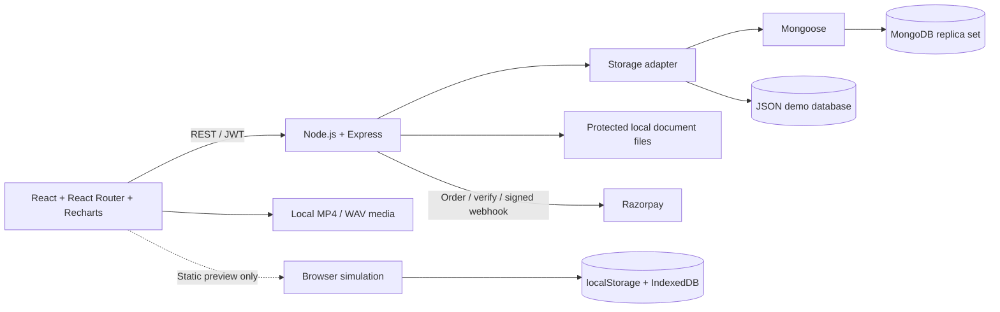

# CareClaim: Medical Mediclaim Management & Visualization System

**Full-stack MERN application · Academic project report · 2026**  
Student: [Name] · Registration number: [Number] · Institution: [College]

## 1. Executive summary

CareClaim digitizes medical claim submission, document handling, review, tracking and analysis. The implementation follows the supplied `MERN_Medical_Mediclaim_Project_Documentation.docx`. The requested additions are a policy-premium payment workflow, original video and music, and a distinctive responsive interface. All included medical records are synthetic.

## 2. Problem and objectives

Paper and spreadsheet workflows separate patient details, bills, decisions and policy balances. This project brings those records into one application, gives each role appropriate access, and makes a claim's status and history visible. Its objectives are secure API access, validated submissions, traceable decisions, useful visualizations and a reproducible development setup.

## 3. Scope mapped to the supplied specification

| Specification requirement | Implemented result |
| --- | --- |
| Patient, hospital, officer and administrator roles | JWT authentication, bcrypt hashes, route authorization and role-specific actions |
| Claim submission, update and status management | Validated forms, pending-claim edits, reviewer remarks, final Approved/Rejected decisions |
| Supporting documents | PDF/PNG/JPEG uploads, signature/size checks, claim-linked protected downloads |
| MongoDB data design | Mongoose models, identifiers, indexes and transactional writes |
| Claim amount, status, gender and age charts | Recharts bar, doughnut and line visualizations; claim activity chart |
| Search, filters and pagination | Claims workspace with search, status tabs, sorting and pagination |
| Profile and reporting | Contact updates, CSV exports, printable analytics and downloadable payment receipts |
| Additional requested features | Premium checkout, original animated explainer, optional ambient music and reduced-motion controls |

## 4. Architecture and technology

The normal application is three-tier MERN. The JSON adapter makes local demonstrations possible without a database account. The hosted static preview is a separate, labelled demonstration of the same interface; it does not run Express or MongoDB.

The frontend uses React functional components, hooks, Vite, React Router, Recharts and Lucide icons. Express provides REST endpoints, JWT middleware, validation, upload handling and payment verification. Mongoose connects to MongoDB. npm workspaces organize client tooling and the server.

## 5. Development methodology

The document was treated as requirements rather than proof of completed work. Implementation separated the API, storage models, client service, interface and original media. Integration checks then exercised permissions, decisions, uploads and payments. Documentation records actual behavior and distinguishes working demonstrations from infrastructure-dependent integrations.

## 6. Database design

| Collection | Main stored fields and indexes |
| --- | --- |
| Users | id, name, unique email, passwordHash, role, phone, createdAt |
| Claims | id, unique claimId, indexed patientId/status/claimAmount/policyNumber, treatment, hospital, age, gender, dates, amount, documents, timeline, remarks, submittedBy |
| Policies | id, unique policyNumber, indexed patientId, coverageAmount, usedAmount, premiumAmount, start/end dates, nextDueDate, billingPeriod, paidPeriods |
| Payments | id, unique orderId, indexed policyId/patientId, receiptId, amount, provider, method, billingPeriod, status, createdAt |
| Payment orders | id, indexed patientId, policyId, amount in paise, currency, provider, gatewayOrderId, billingPeriod, expiry and status |
| Documents | id, indexed claimId, stored file path and metadata; file access requires claim permission |
| Audit logs | id, actorId/name, action, targetId, detail and indexed timestamp |

MongoDB transactions keep related writes consistent. JSON mode serializes mutations and persists with a temporary-file rename. The current adapter caches state, so one API process is supported; the API must be restarted after operator provisioning.

## 7. Roles and claim lifecycle

| Action | Patient | Hospital | Officer | Admin |
| --- | --- | --- | --- | --- |
| View claims/policies | Own | All | All | All |
| Submit claim | Own policy | For a patient | No | For a patient |
| Edit/upload to pending claim | Own | Own submissions | No | All |
| Approve/reject pending claim | No | No | Yes | Yes |
| Pay policy premium | Own | No | No | No |
| View payment records | Own | Own, normally none | All | All |
| View audit history | No | No | Yes | Yes |

Submission creates a Pending claim and timeline entries. A reviewer records a decision with a 5–2000-character note. Approval checks remaining policy coverage and updates usage atomically. Final decisions cannot be overwritten. Public registration creates patients only; an operator CLI provisions staff and assigns issued policies.

## 8. Backend API

Authentication uses `/api/auth/register`, `/api/auth/login`, `/api/auth/me` and `/api/auth/profile`. Claims use `/api/claims`, `/api/claims/:id`, `/api/claims/stats` and `/api/claims/:id/documents`. Other resources are `/api/policies`, `/api/payments`, `/api/documents/:id` and `/api/audit`.

Premium checkout uses `/api/payments/order`, `/api/payments/verify` and an optional signed `/api/payments/webhook`. Protected endpoints require a bearer token. The [server reference](../server/README.md) documents request fields, validation and operator commands; the accompanying Postman collection demonstrates the endpoints.

## 9. Frontend and original additions

The interface includes an overview, claims workspace, policy cards, payments, insights, document vault, care corner, profile settings and reviewer activity history. Layouts adapt to desktop, tablet and phone sizes. Claim timelines connect user-visible updates to stored events. Charts reflect records permitted by the current role.

The care corner includes an original 16-second, 960×540 H.264 MP4 walkthrough, English captions and a local poster. A separately composed 24-second WAV instrumental loop plays only after user interaction. Animated illustrations and step guidance support the visual design; reduced-motion preferences limit interface animation. Asset generation source and provenance are included under `client/public/media/`.

## 10. Payment modes and safeguards

Without gateway keys, permitted development checkout simulates a premium payment and produces a clearly labelled sandbox receipt. Browser preview also simulates checkout. Neither transfers money. With Razorpay keys, the server creates an order from the stored premium, verifies the checkout HMAC, and confirms captured amount, currency and gateway order before settlement.

Settlement is idempotent by order and policy billing period. Orders expire after 30 minutes, prepayment is limited to 90 days, and payment advances the annual due date without extending the policy contract. The gateway webhook shares the settlement path. Premium collection does not implement insurer claim payouts. Live merchant activation, credentials, HTTPS and integration testing require operator infrastructure.

## 11. Validation and observed outcomes

At the final verification, **9 backend tests, 1 browser-adapter test and 4 browser journeys passed**. The production frontend build and a separate built-bundle sandbox checkout check also passed. Coverage includes authentication, ownership, role restrictions, claim review, file signatures, protected downloads, payment amount/signature/capture checks, duplicate settlement, signed webhook behavior, persistence and mutation rollback. The preview test checks scoped records, forbidden actions and sandbox payment idempotence.

Run `npm test` for these checks and `npm run build` for the production client build. Browser checks cover document-backed claim submission, pending editing, sandbox checkout and receipts, officer decisions and audit history, mobile navigation, original video metadata and persistent preview payments. Configured MongoDB, Docker and live gateway verification remain environment-dependent checks. No claim is made that the system reduced processing time or error rates: no operational benchmark or real institutional trial was performed.

## 12. Limitations and operational requirements

The JSON database and static browser preview are for synthetic demonstrations. Browser accounts are a simulation and do not provide server-enforced security. MongoDB mode requires a replica set and currently supports one API instance. Uploaded files need deployment-specific storage management and malware scanning. Real installations require HTTPS, secret management, backups, monitoring, retention policies and institution-specific privacy/compliance review. This project does not claim regulatory certification. Docker configuration is supplied; container execution depends on host availability.

## 13. Conclusion and future scope

CareClaim implements the specified claim-management and visualization workflow with an additional premium-payment section and original media. Useful next work includes direct-query storage for multiple API instances, managed document storage/scanning, automated notifications, insurer reconciliation and carefully evaluated decision-support services. These are extensions rather than features claimed by the current implementation.

## 14. References and submission materials

See [project setup and operation](../README.md), [API and provisioning](../server/README.md), [media provenance](../client/public/media/README.md) and [Postman collection](CareClaim.postman_collection.json). The implementation follows Razorpay's official [checkout integration](https://razorpay.com/docs/payments/payment-gateway/web-integration/standard/integration-steps/) and [payment fetch API](https://razorpay.com/docs/api/payments/fetch-with-id/). The supplied DOCX remains the original project specification.
